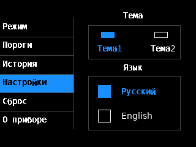
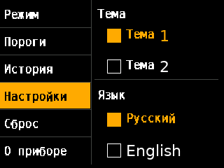

# DMT-99 Russian / English firmware patch

[](https://github.com/paulcodeman/dmt99-russian-firmware/actions/workflows/build-release.yml)

Русификация заводского приложения **FNIRSI DMT-99 V2.4**: русский заменяет
китайский пункт, английский сохраняется. Поддерживаются обе темы.

**Экспериментальная сборка. Физический запуск и точность измерений пока не подтверждены.**
Программные проверки не заменяют проверку на самом приборе.

| Компактная тема | Крупная тема |
| --- | --- |
|  |  |

Изображения получены программным исполнением UI; это не фотографии прибора.

## Скачать и получить BIN

1. Откройте [Releases](https://github.com/paulcodeman/dmt99-russian-firmware/releases).
2. Скачайте и распакуйте `DMT99-RU-EN-vX.Y.Z.zip`.
3. Установите Python 3.10+ и выполните из распакованного каталога:

```powershell
python make_firmware.py
```

Утилита скачает официальный образ FNIRSI, проверит его SHA-256, применит патч
и проверит итоговый файл **DMT99RU.BIN**. Компилятор не нужен. Если оригинальный
файл уже скачан, передайте `--original путь/к/оригиналу.BIN`.

Утилита сама не обращается к мультиметру. **IPS и overlay.bin не предназначены
для загрузчика** — нужен полученный DMT99RU.BIN. На диске BOOT должен быть один
выбранный BIN. Используйте штатный режим POWER + AUTO/MENU и инструкции,
показанные загрузчиком. В информации о приложении ожидается **DMT 2.4RU**.

Сохраните официальную V2.4 для возврата через работающий загрузчик.
Восстановление после неудачного обновления не гарантируется.

## Что изменено

- Основные меню, выбор языка, предупреждения, подписи режимов и истории.
- Встроенный кириллический шрифт; перевод рисуется без изменения внешней Flash.
- Пять входов в функции отображения и подпись версии заменены в оригинальном
  образе. Остальные байты исходного приложения сохраняются.
- Оригинальные заголовок и таблица векторов сохраняются. Код загрузчика,
  обработка измерений и сохранение настроек не заменяются.
- English использует штатные функции; первый пункт выбора языка называется «Русский».
- Обозначения DC/AC, единицы измерения и компактные символы режимов сохранены.

Готового русского перевода в исследовательском проекте не было: присутствовали
номер языка и путь `menu/russian/`, но отсутствовали соответствующие ресурсы.
В этом репозитории перевод реализован отдельной надстройкой поверх V2.4.

## Сборка и проверки

Ubuntu 24.04 / WSL Ubuntu, Python 3.12:

```bash
sudo apt-get update
sudo apt-get install gcc-riscv64-unknown-elf binutils-riscv64-unknown-elf fonts-dejavu-core
python3 -m venv .venv
. .venv/bin/activate
pip install -r requirements.txt
python tools/fetch_inputs.py
python tools/build.py
python -m unittest discover -s tests -v
python tools/verify.py
python tools/package_release.py
```

Результаты: `build/DMT99RU.BIN` для локальной проверки и `dist/` с публичным
пакетом патча. Официальный BIN и исследовательские данные скачиваются в `.cache/`
и проверяются по закреплённым контрольным суммам. Они не включаются в Git/релиз.
Пути можно переопределить через `DMT99_ORIGINAL`, `DMT99_UPSTREAM`, `DMT99_CROSS`
и `DMT99_FONT`. Для Windows инструменты сборки вызывают WSL Ubuntu.

Проверки исполняют инструкции надстройки вместе с оригинальными функциями,
заменяя аппаратные операции программным экраном:

- 128 сочетаний состояния меню, темы и языка;
- четыре перехода русского ↔ английского с сохранением штатных эффектов настроек;
- 44 китайских изображения с подписями и смысл выделения «Назад»/«Сбросить»;
- сохранность стека, gp и сохраняемых регистров;
- неизменность исходного кода вне перечисленных UI-изменений;
- воспроизведение проверенного BIN из готового ZIP утилитой пользователя.

Это проверки интерфейса и структуры патча. Аппаратные задержки, точность,
электрическая безопасность и возможность восстановления ими не подтверждаются.

## Автосборка релизов

На `push` в `main`, Pull Request и ручной запуск Actions выполняются сборка,
проверки и упаковка артефакта `release-assets`.

Для нового релиза обновите `VERSION`, затем отправьте соответствующий тег:

```bash
git tag v0.1.0
git push origin v0.1.0
```

Workflow проверяет совпадение тега с `VERSION`, собирает и тестирует пакет,
проверяет SHA-256 загруженных артефактов и публикует **prerelease** автоматически.
Дополнительный токен не нужен: права записи есть только у задания публикации.
Для следующей версии используйте новый номер и новый тег.

## Происхождение

[Исследовательский проект DMT-99](https://github.com/smhgzll/dmt-99-multimeter-custom-firmware)
помог установить адреса и поведение заводских функций. Это не заводские исходники
FNIRSI. Версия и контрольные суммы тестовых входов закреплены в `inputs.lock.json`.

Наш код — MIT; шрифт — Bitstream/DejaVu. Заводская прошивка и внешние данные
имеют отдельные права. Подробности — [NOTICE.md](NOTICE.md).
